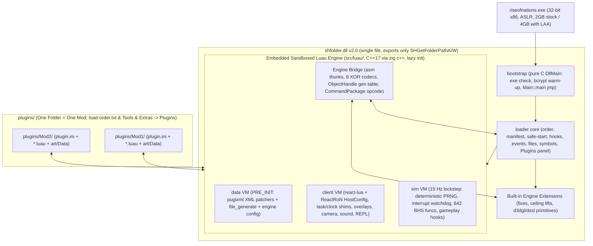
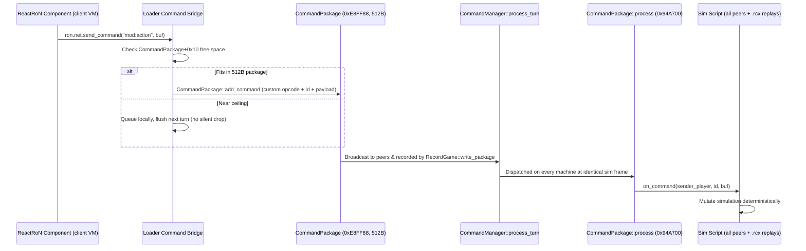

# RoN-Plugin-Loader v2.0 (Luau-Only Engine API & `react-lua` UI): Final Implementation Plan

## Goal Description

Build **RoN-Plugin-Loader v2.0** (`shfolder.dll`) on a dedicated long-lived integration branch (`loader-v2-luau` in `RoN-Plugin-Loader`, with per-phase task worktrees branched off and merged back into `loader-v2-luau`, leaving `v1.1` untouched on `main` until final cutover). This turns `shfolder.dll` into a **100% sandboxed Luau mod platform and Rise of Nations engine API** with third-party `.dll` plugin loading retired.

The end goal is an API rich and clean enough to **convert every feature of `RON Revived` (all 72 native C files) into Luau mods**, developed and verified piece by piece:
1. **Single native binary (`shfolder.dll`)**: Owns bootstrap (`Main::main`), shared hooks, file virtualization (`file_use`/`file_folder`/`file_generate`), reusable engine fixes/ceiling lifts, DX11/audio/UI host primitives, and the embedded Luau runtime. Exports remain strictly `SHGetFolderPathA` / `SHGetFolderPathW`.
2. **One folder = one mod (Luau-only)**: Every mod is a single self-contained subfolder `<game>\plugins\<ModId>\` holding `plugin.ini`, optional `.luau` scripts (`data.luau`, `sim.luau`, `client.luau`), and optional game-layout art/data files (`Data\`, `art\`, `sounds\`)—allowing file-only folders too. Zero C compiler, zero DLLs, zero `Folder=` collisions, zero ABI fragility, safe against antivirus/RCE, and cleanly hashable for multiplayer lobbies and future Steam Workshop support.
3. **Declarative native-styled UI**: Ships **`jsdotlua/react-lua`** (pre-compiled shared bytecode) mounted onto a custom C++ **`ReactRoN` HostConfig** rendered through RoN's own `IFaceRenderManager`, `Buffer`, and `FontFamily`.
4. **Lockstep multiplayer & replay safety**: Three isolated Luau realms (`data` / `sim` / `client`), custom lockstep commands inside `CommandPackage`, and save-game persistence inside the unused `ScenarioData::temp_save` (`0x00E88AFC`) `.SVX` string slot.

---

## Locked-In Decisions

> [!IMPORTANT]
> All core architectural and workflow decisions have been confirmed:
> - **Branching & DLL Deprecation**: Publish **`loader-v2-luau`** in `RoN-Plugin-Loader`, cut per-phase task worktrees from `loader-v2-luau` (merging each verified phase into `loader-v2-luau`), and merge `loader-v2-luau` → `main` only when v2.0 is complete. On `loader-v2-luau`, third-party `LoadLibrary` DLL loading and `include/ron_plugin.h` are retired; `main` retains v1.1 for legacy `RON Revived.dll` in the meantime.
> - **One Folder = One Mod**: Mods live at `<game>\plugins\<ModId>\plugin.ini` (alongside their scripts and game-layout assets; file-only mods with no `.luau` scripts are also valid).
> - **UI-First Ordering**: Bring up **basic playable UI (`jsdotlua/react-lua` + `ReactRoN` + updated Plugins panel)** in **Phase 2**, immediately after the Phase 1 Luau VM core and console REPL.
> - **Dependencies & Toolchain**: Fetch pinned upstream releases (`luau-lang/luau`, `pugixml`, `jsdotlua/react-lua`) into git-ignored `third_party/` via `tools/fetch_deps.ps1` (keeping the repository lean and builds reproducible). Compile inside `RoN-Plugin-Loader/build.ps1` using **`python -m ziglang c++ -target x86-windows-gnu -O2 -msse2 -mstackrealign -std=c++17 -DLUA_USE_LONGJMP=1`** into a cached `build\libluau.a`.
> - **Save Persistence**: Store compressed, encoded Luau save state directly inside **`ScenarioData::temp_save` (`0x00E88AFC`)** so `.SVX` files remain 100% self-contained (including multiplayer OOS recovery `Temp\OOS_RECOVERY.SVX`). Verify `String::walk_data`'s max string length in Phase 4; add an overflow sidecar `<save>.SVX.luau` **only** if a hard cap is hit.
> - **Maximum Safe First-Release Coverage (No Raw Memory Escape Hatch)**: `shfolder.dll` **never** exposes raw `mem.read`/`mem.write`/`call_addr` APIs to Luau (arbitrary memory writes defeat sandboxing and equal native DLL RCE). Instead, `shfolder.dll` uses our complete `rise.pdb` (19,863 struct layouts) + `rise_z.map` (54,255 functions) + `ScenarioFuncSet` (842 typed functions) to auto-generate broad, validated, memory-safe Luau bindings: all 732 `rules.xml` constants, rich typed fields on core structs (`Game`, `Leader`, `Unit`, `Build`, `City`, `World`, `TypeData`, `Camera`, `ConquestGame`), all 842 BHS functions, runtime HLSL shader overrides (`shaders\*.hlsl`), and built-in engine ceiling lifts (`ron.engine.*`).

---

## Architecture Overview

### 1. System Architecture (`shfolder.dll` v2.0)

### 2. Three Isolated Realms (Lockstep Safety by Construction)

From RoN-Engine-Atlas sync.html and RoN-Engine-Atlas game-loop.html, RoN is deterministic lockstep at 15 Hz with per-turn `adler32` checksums over units, buildings, `Guy` models, `DeathObj` corpses, leaders, rules, and scripts. `shfolder.dll` isolates mods into three realms (one frozen-stdlib `lua_State` per realm + one `luaL_sandboxthread` per mod):

1. **`data` realm (`PRE_INIT`)**: Deterministic XML/data generation over `fs_generate` (`pugixml` DOM) + declarative engine ceiling configuration before `Game::init_rules_data`.
2. **`client` realm (UI / Render / Input / Audio / Lobby)**: Hosts `jsdotlua/react-lua` + `ReactRoN`, immediate-mode `ron.overlay`, camera, sound, hotkeys, console REPL, and read-only simulation snapshots. Sends player actions to `sim` via `GroupOut::issue_*` or custom lockstep commands (`ron.net.send_command`).
3. **`sim` realm (15 Hz Lockstep)**: Full simulation read/write (`match`, `players`, `units`, `buildings`, `world`, `types`, `combat`, `abilities`, `ai`, `ctw`, gated `bhs`). Strictly blocks wall clock, local camera, local keyboard, local selection, and filesystem. Overrides `math.random` with xoshiro256** seeded from `world+0x7C` so `GameAccess::game_random` (`0x00E37A8C`, 321 callers) is never perturbed.

### 3. `jsdotlua/react-lua` + `ReactRoN` HostConfig

Running `jsdotlua/react-lua` natively inside RoN's 32-bit, single-core `client` VM:
- **Bundled & Pre-Compiled Shared Bytecode**: Vendor `React`, `ReactReconciler`, `Scheduler`, `Shared`, and `LuauPolyfill` (MIT, omitting `ReactRoblox`). `tools/bundle_react.py` rewrites Roblox `script.Parent` requires to Luau string-requires and compiles to embedded bytecode loaded once into the frozen `client` stdlib (`__DEV__ = false` by default; `luau_dev on` toggles React dev warnings).
- **Client-Only Standalone Shims**: `task` (`spawn`/`defer`/`delay`/`cancel`, pumped in `Game::loop_render` / `Window::modal_idle` right before `IFaceRenderManager::flush_all` `0x0051FBE0`), `os.clock()` (`QueryPerformanceCounter`), `warn(...)` (`loader.log` + `ConsoleWin::text`), and safe read-only `debug.traceback`.
- **60 FPS Performance**: High-frequency HUD values (resources, timers, progress bars) use **`React.useBinding`** to push updates directly to C++ `UINode` properties without Fiber diffs; high-count world-space graphics (100+ health bars, rank stars, range circles) use the immediate-mode `ron.overlay` fast path.
- **Native RoN Host Primitives (`src/luau/ui_host.cpp`)**:
  - `panel` / `box` (flexbox + RoN edge anchors `right_inverse`/`bottom_inverse`; native themes `wood_frame`, `dark_pane`, `diplo_popup`, `scroll_bg`),
  - `text` (`Buffer::write_l`/`write_cent_l`/`write_right_l`/`wrap` + `FontFamily::get` `0x00522810`, auto-backed by textured plate to prevent terrain halos),
  - `image` (`IFaceRenderManager::add`/`add_smooth`, atlas slices, unit/order/alert icon cells `(col, row)`, mod `.tga` textures registered into `IFACERENDERMANAGER`),
  - `button` / `checkbox` (`wrapper_pieces_02.tga` art, click sounds `0xAF`/`0x111`, `Window::mouse_capture` `0x00E334F4` click swallowing so map clicks never leak),
  - `scroll` (clipped scroll + wheel), `input` (keyboard focus capture), `tooltip` (virtual `Scene::load_help_key` `0x008BD7F0` / `HelpBox`),
  - Four mount roots: `ReactRoN.createRoot("hud" | "menu" | "setup" | "modal")`, with live hot-reload via `luau_reload`.

### 4. RoN Engine Hazards Solved Inside `shfolder.dll`

| Engine Hazard (Atlas Reference) | Built-in Loader Solution |
|---|---|
| **32-bit address space (2 GB stock / 4 GB with LAA), single core** (RoN-Engine-Atlas executable.html) | Because Windows reads the PE LAA bit before `shfolder.dll` loads, the 4 GB patch must be applied on disk (installer/setup step; `shfolder.dll` checks LAA at startup and warns on the Plugins panel if Steam resets it). Shared frozen stdlib per realm, custom allocator caps, and per-frame `interrupt` watchdogs keep Luau lean on both 2 GB and 4 GB setups. |
| **32-bit stack align & MSVC C++ frames** ([build.ps1](../../build.ps1)) | `-msse2 -mstackrealign` + `LUA_USE_LONGJMP=1`; every hook boundary uses `lua_pcall` + `lua_debugtrace`—zero exceptions ever cross into `riseofnations.exe`. |
| **Private LTCG calling conventions** (RoN-Engine-Atlas plugin-loaders.html) | Audited assembly/`__fastcall` thunks (`src/luau/engine_thunks.c`) for `Main::main`, `LobbySetKey`, `JukeBox::set_next_mood`, `IFaceRenderManager::add_smooth`, `draw_health_bar`, `world_to_console`, `GetTopMenuXMLFile`. |
| **Non-copying `String(wchar_t*)` & 512 UCRT `FILE` cap** (RoN-Engine-Atlas data-files.html) | Owning `RonString` RAII helper; scripts read via Win32 `CreateFileW`/`ReadFile`/`CloseHandle` (zero UCRT stdio slots held). |
| **Object slot reuse & Bribe/Capture ID changes** (RoN-Engine-Atlas objects.html, RoN-Engine-Atlas abilities.html) | Shadow `g_obj_gen[8][3000]` hooked onto `init_unit`/`init_build`/`die`/`disband`/vtable `+0x94`; 8-byte `ObjectHandle` userdata with O(1) `:is_valid()`, squad helpers, `on_owner_changed(old, new)`, and unused `Unit+0x6C` bits `20..31` mod flags. |
| **8 XOR-scrambled fields & mixed units** (RoN-Engine-Atlas game-loop.html, RoN-Engine-Atlas players.html) | Transparent C++ codecs (`0x63637`, `0x8221`, `0x1281`, `0x872`, `0x90236`, `0x8932`, `0x62766`, `0x63187`), 192-unit tiles (`vector`), binary angles, sixteenths HP (`+0x3B`). |
| **Crash traps** (RoN-Engine-Atlas abilities.html, RoN-Engine-Atlas players.html, RoN-Engine-Atlas rendering.html) | Blocks `UnitType.POP = 0` (AI div-by-zero); validates craft `0x275..0x2AB` (Carrier crash); fixes `Unit::do_cast` ground-target `-1` null deref; caps `draw_circle` batch <16,383 verts (`int3` crash). |

---

## Phased Implementation Roadmap (`RoN-Plugin-Loader` Branch `loader-v2-luau`)

Every phase runs on its own task worktree cut from `loader-v2-luau` and merges back into `loader-v2-luau` once verified.

### Phase 1 — Luau-Only Loader Core, Embedded Luau VM & Live REPL

#### [MODIFY] [version.h](../../src/common/version.h), [manifest.h](../../src/loader/manifest.h), `manifest.c`, [order.c](../../src/loader/order.c), [loader.h](../../src/loader/loader.h), [loader.c](../../src/loader/loader.c), `panel.c`, [build.ps1](../../build.ps1)
- Bump version to `2.0.0`. Retire third-party `LoadLibrary` DLL loading and `api.c` / `include/ron_plugin.h` on `loader-v2-luau`; keep `shfolder.dll` single-file with only `SHGetFolderPathA`/`W` exports.
- Switch to **one folder = one mod**: `order_discover()` scans immediate subfolders `plugins\<ModId>\` (ignoring dot-folders like `.cache`) that contain `plugin.ini` with a `[Plugin]` section.
- Update `manifest_parse()` to read optional `DataScript`, `SimScript`, `ClientScript` under `[Plugin]` (validated relative to the mod's own folder; drop the obsolete `Folder=` indirection). Mods with zero scripts still work cleanly as file-only art/data mods.
- Exclude `plugin.ini` and `*.luau` from `fs_folder` game-file serving so mod metadata/scripts never leak into game folder listings.
- Update `panel.c` Description box to show mod folder, active scripts, served file counts, and exact Luau file:line error messages on `LP_FAILED`.
- Add `tools/fetch_deps.ps1` to download pinned release tags of `luau-lang/luau` (`Common`, `Ast`, `Compiler`, `VM`) and `pugixml` into git-ignored `third_party/`; compile into cached `build\libluau.a` via `python -m ziglang c++ -target x86-windows-gnu -O2 -msse2 -mstackrealign -std=c++17 -DLUA_USE_LONGJMP=1`.

#### [NEW] `src/luau/` core
- `luau_host.h` / `luau_host.cpp`: lazy-initialized `data`/`client`/`sim` VMs (zero VMs / zero extra hooks when no Luau mod is enabled), `luaL_sandbox` / `luaL_sandboxthread`, memory cap allocator, `interrupt` watchdog, `require("@ron/...")` / `require("@mod/...")` / relative `require()`, and error logging to `loader.log` + `ConsoleWin::text`.
- `engine_thunks.c` & `ron_string.cpp`: audited assembly thunks + owning `RonString` RAII helper.
- `bind_console.cpp`: hooks `ConsoleWin::parse_cmd` (`0x007D6470`) for `luau <expr>`, `luau_sim <expr>`, `luau_dev on|off`, and `luau_reload` (hot-reloading `client` scripts live).

---

### Phase 2 — Basic Playable UI (`jsdotlua/react-lua` + `ReactRoN` HostConfig)

#### [NEW] `tools/bundle_react.py`, `src/luau/client_shims.cpp`, `src/luau/ui_host.cpp`, `src/luau/bind_client_ui.cpp`
- Extend `tools/fetch_deps.ps1` with pinned `jsdotlua/react-lua` (`React`, `ReactReconciler`, `Scheduler`, `Shared`, `LuauPolyfill`) into git-ignored `third_party/react-lua/`, and build `tools/bundle_react.py` to rewrite requires and generate embedded pre-compiled bytecode loaded once into the `client` VM (`require("@ron/react")`, `require("@ron/react-ron")`).
- Implement `client`-only `task` (`spawn`/`defer`/`delay`/`cancel`), `os.clock`, `warn`, and safe `debug.traceback` shims pumped before `IFaceRenderManager::flush_all` (`0x0051FBE0`).
- Build C++ `ui_host.cpp`:
  - Retained `UINode` tree (`panel`, `box`, `text`, `image`, `button`, `checkbox`, `scroll`, `input`, `tooltip`) with flexbox + RoN edge-anchor layout (`left`/`top`/`right_inverse`/`bottom_inverse`).
  - Native rendering via `IFaceRenderManager` (`0x00EBD1C0`), `Buffer::write_*` (`0x0050F6E0`), `FontFamily::get` (`0x00522810`), native frames/art (`wrapper_pieces_01.tga`, `wrapper_pieces_02.tga`, `TEX_DIPLO`, `TEX_CIV`), automatic textured backing under text, and `Window::mouse_capture` (`0x00E334F4`) click/wheel swallowing.
  - Dynamic tooltips via `Scene::load_help_key` (`0x008BD7F0`) / `HelpBox` hook.
  - Mount roots: `"hud"`, `"menu"`, `"setup"`, `"modal"` + `React.useBinding` direct-property update path.
- Ship `plugins/HelloReact/` example mod demonstrating a playable interactive HUD/menu widget + live `luau_reload`.

---

### Phase 3 — Core Simulation API & `ScenarioFuncSet` 842-Function Bridge

#### [NEW] `src/luau/handles.cpp`, `src/luau/bind_bhs.cpp`, `src/luau/bind_sim.cpp`
- Shadow `g_obj_gen[8][3000]` generational handle table (`Objects::init_unit` `0x0065E0C0`, `Objects::init_build` `0x0065D190`, `Object::die` `0x00647080`, `Object::disband` `0x006455C0`, owner-change vtable `+0x94`).
- Generic `ScriptParamStack` marshaler exposing all 842 `ScenarioFuncSet` functions (realm-gated between `sim` and `client`, including 93 `ctw_*` functions).
- Direct `sim` + read-only `client` snapshot bindings:
  - `ron.match` (`Game`, `TurnControl`, `Constants`),
  - `ron.players` (8 XOR-decoded leader records: treasury, caps, rates, ages, research, pop, diplomacy, techs, owned/queued counts),
  - `ron.units` & `ron.buildings` (safe `ObjectHandle`, XOR positions as `vector`, facing, HP/sixteenths, mana, flags, `Unit+0x6C` bits 20–31 mod flags, squads, queues, deterministic `Group::action_*`),
  - `ron.world` (block flags, tile masks, territory, height, `blocked_site`),
  - `ron.types` (read-only frozen views + `POP != 0` validator),
  - Deterministic xoshiro256** `math.random` seeded from `world+0x7C`.

---

### Phase 4 — Deep Gameplay Hooks, Lockstep Commands & Hidden `.SVX` Persistence

#### [NEW] `src/luau/bind_net.cpp`, `src/luau/bind_gameplay.cpp`, `src/luau/bind_save.cpp`
- **Custom Lockstep Commands (`bind_net.cpp`)**: Hook `CommandPackage::process` (`0x0094A700`) for a dedicated custom Luau opcode; implement `ron.net.send_command(id, buf)` with 512-byte overflow guard & next-turn queue, plus `GroupOut::issue_*` wrappers (automatic MP sync + `.rcx` replay playback!).
- **Combat, Abilities, AI & CtW (`bind_gameplay.cpp`)**:
  - Combat: `ObjectData::get_damage` (`0x00644130`), `Object::take_damage` (`0x00652020`), `Unit::suffer_attrition` (`0x005E1A10`).
  - Abilities: `SpellTypeData::is_castable` (`0x00675BC0`), `SpellType::cast` (`0x00676CE0`), `UnitOut::make_options` (`0x00615FC0`), and the ground-target `-1` null-deref fix in `Unit::do_cast` (`0x005EBFE0`).
  - AI: `MakeList::make_me` (`0x006C9BE0`), `Leader::plan_strategy` (`0x006B9620`), `Unit::think` (`0x005F6E40`).
  - CtW: direct `conquest_game` (`0x00E86880`) accessors.
- **Hidden `.SVX` Save Persistence (`bind_save.cpp`)**:
  - Verify `String::walk_data`'s serialized length cap in the binary.
  - Hook around `SaveGame::do_save` (`0x005A81F0`) / `LoadGame::do_load` (`0x005A6E30`): invoke `on_save()` across `sim` mods, encode deterministically + compress + prefix (`RONLUAU1:`) into `ScenarioData::temp_save` (`0x00E88AFC`), and restore on load (`on_load(state)`). Only add an overflow sidecar `<save>.SVX.luau` if `String::walk_data` enforces a tight ceiling.

---

### Phase 5 — `data` Realm (XML Generators), World Overlays, Audio, Lobby & Built-in Engine Extensions (`Revived-Mod` Parity)

#### [NEW] `src/luau/bind_data.cpp`, `src/luau/bind_client_world.cpp`, `src/engine_ext/`
- **`data` Realm (`bind_data.cpp`)**: `ron.data.patch_xml(game_rel, fn)` over `fs_generate` + `pugixml` DOM, plus `use_file` / `file_path`.
- **World Overlays, Camera, Sound & Lobby (`bind_client_world.cpp`)**:
  - `ron.overlay` immediate-mode fast path (unit health bars, world-space text/icons, batch-capped `GraphicPieces::draw_circle` <16,383 verts, `Underlays::add`).
  - `ron.camera` (`Camera` `0xC06200`: `on_scroll_tick`, `on_zoom_in`/`out`, `get/set_pos`, continuous `get/set_distance`, `set_zoom_filter`, `world_to_console` `0x583840`, tilt/shake) + `ron.input.is_key_down_live` (`GetAsyncKeyState` for zero-tick-lag smooth camera scrolling).
  - `ron.sound` (`SoundGlobal::play` `0x97F770`, `JukeBox::set_next_mood` `0x97D5D0`), `ron.input` hotkeys, `ron.hud` notices/chat/mouseover/selection, `ron.minimap.*`, and `ron.lobby` custom lobby keys (`LobbySetKey` `0xA30B70`, `UpdateLobbyFromDTO` `0x962C70`).
- **Built-in Engine Extensions (`src/engine_ext/`)** — the ~15–20 low-level engine upgrades from `Revived-Mod` exposed declaratively to `data`/`client` Luau mods so no DLL is needed:
  - Always-on / configurable engine fixes: zero-length animation hang fix (`Guy::inc_time`), `DeathObj` corpse pool size (>100), population-limit choices (>6), removable 999 commerce cap, smooth 360° model & aircraft facing, >24 nation support (`Tribes` re-init at `Main::main`), >5 language support, selection-group helpers (`bigsel`), crash minidump handler.
  - `d3dgl.dll` & sprite hooks (`RON_EV_LIBRARY`): per-nation building sprite override (`ron.render.set_building_sprite(nation, type, age, path)` on `BuildTypeOut::draw`), tone-mapper / post-FX / FXAA / water / fog / outline uniforms + custom `.hlsl` shader overrides via the file service, sprite subpixel alignment, and `ron.ui.set_scale`.

#### `RON Revived` README Parity Checklist (12 / 12 Covered)
1. **Romania (25th nation)** → `ron.engine.set_nation_count(25)` + `data.luau` XML/art.
2. **Nation-specific building art** → `ron.render.set_building_sprite(...)` + `art/` files.
3. **City districts, Airdrop, Field Fortifications, General's Heal** → `sim.luau` (`ron.abilities` + ground-target fix + `ron.buildings`/`units`) + `data.luau`.
4. **Improved missile defence** → `sim.luau` missile/damage hooks + `ron.constants`.
5. **Veteran ranks, kills & unit info** → `sim.luau` (`on_object_died`, `on_get_damage`, `Unit+0x6C` mod flags, `temp_save`) + `ReactRoN` panel & `ron.overlay`.
6. **Survival mode** → `sim.luau` wave director + `ReactRoN` objectives HUD & menu entry.
7. **Smooth scrolling, zoom & movement** → pure Luau `ron.camera` + `is_key_down_live`, `ron.engine.smooth_facing(true)`, `sim.luau` movement hooks.
8. **Resizable HUD/minimap & panels** → `ReactRoN` + `ron.ui.set_scale` + `ron.minimap.*`.
9. **Build previews, selection, hotkeys, production feedback** → `ron.hud`, `ron.input`, `ron.overlay`, selection helpers.
10. **Extra setup options (pop limits, unit bans, nuke rules)** → automatic >6 pop-limit lift + `ReactRoN` `"setup"` root + `ron.lobby` + `ron.types.disable`.
11. **Post-FX, water, softened fog & FXAA fixes** → `d3dgl.dll` uniforms (`ron.render.*`) + `.hlsl` shader overrides + `ReactRoN` settings UI.
12. **In-game Plugins menu** → built into `shfolder.dll` (`Tools & Extras → Plugins`), one-folder-per-mod layout.

---

### Phase 6 — `rise.pdb` Codegen SDK, `luau-lsp` Types & `Revived-Mod` Migration

#### [NEW] `tools/gen_bindings.py` + `sdk/`
- Reads `<game>\sbl\rise.pdb`, `rise_z.map`, and `spec/api.json` to emit verified C++ offset headers, `sdk/types/ron-{data,sim,client,react,react-ron}.d.luau` + `.luaurc` for VS Code `luau-lsp` strict checking, and API docs.
- Begin converting `Revived-Mod` features piece by piece into Luau mods on top of the v2.0 API (starting with clean standalone features like `ranks` / `kills`, `entrench` / `rally` / `airdrop`, `unitbans`, `survival`, and HUD panels).

---

## Verification Plan

All verification runs offline or inside `devtools/game-mirror` so the live Steam install is never touched.

### Automated Tests (`powershell -File build.ps1 -Test`)
1. **Loader & Exports**: `shfolder.dll` exports strictly `SHGetFolderPathA`/`W`; version resource matches `2.0.0`; with zero Luau mods enabled, `luau_is_active() == 0` (stock behavior untouched).
2. **Discovery, Load Order & Rollback**: Pure-Luau mods settle into `load-order.txt`; compile/runtime load errors roll back cleanly and report file:line in `LP_FAILED`; `*.luau` files never appear in `fs_folder` game file listings; `require("@mod/<id>")` respects load order.
3. **Sandboxing & Watchdogs**: `io`/`os`/`debug` absent; per-mod global isolation; infinite loop aborted by `interrupt` watchdog; runaway allocation caught by allocator cap.
4. **Headless `react-lua` + `ReactRoN` Tests**: Mount/update/unmount, `useState`, `useEffect`, `useBinding` direct-property fast path, `ErrorBoundary`, layout/hit-testing, and click dispatch against a mock `UINode` tree.
5. **Engine Codecs, Handles, Framing, Serialization & XML**: Round-trip tests for all 8 XOR keys, generational handle invalidation/owner-change, 512-byte `CommandPackage` overflow deferral, deterministic `RONLUAU1:` `temp_save` encoding/compression, and multi-mod `DataScript` XML composition.
6. **Static Type Check**: `luau-analyze` passes with zero errors across `sdk/types/*.d.luau` and all example mods.

### Unattended In-Game Integration Tests (`devtools/game-mirror` + `devtools/rondbg`)
Using `devtools/game-mirror/mirror.py make <dir>` + `RON_DIR=<dir>` + `python -P -E devtools/rondbg/rondbg.py start --autostart "--switch=-automation" --unpause`:
1. **Phase 1 Smoke**: Pure-Luau mod loads cleanly, `rondbg console "luau return 2 + 2"` returns `4`, `luau_reload` reloads `client` script without restart.
2. **Phase 2 UI Smoke**: `HelloReact` mounts cleanly in `hud` and `menu` roots with zero crashes; visual check confirms native RoN styling, no bucket z-fighting, no text halos, and clicks don't pass through to the map.
3. **Phase 3–4 Sim, Replay & Hidden Save**: Spawn/damage hooks verified via `rondbg get`; `.rcx` replay with custom `ron.net.send_command` finishes with `"Game completed without desync"` in `SyncLog`; `AutoSaveLoad` / `SaveGame` round-trips `ScenarioData::temp_save` Luau state intact with zero sidecar files.
4. **Multiplayer Check (Manual, Two Instances)**: Lobby check hashes Luau scripts/assets, blocks mismatches, and keeps custom commands synced across turns.
